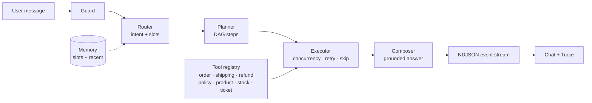

# Orchestrator Playground

Demo mini (Next.js 15, App Router) để học **lớp orchestration** khi xây chatbot: quyết định *gọi gì*, *theo thứ tự nào*, *lỗi thì làm sao*, *nhớ gì giữa các lượt*. Toàn bộ chạy local, không cần API key — router/planner/composer dùng rule + template để mọi quyết định đều đọc được, nhưng giữ đúng contract để thay bằng LLM thật.

```bash
npm install
cp .env.example .env.local   # điền ROUTER_API_KEY nếu muốn bật LLM
npm run dev                  # http://localhost:3000
```

Không có key vẫn chạy đầy đủ ở chế độ rule-based.`

## Chế độ rules vs LLM (9router)

Mỗi lượt request nhận `useLlm: boolean`; UI có checkbox **LLM bật/tắt** (tự disable nếu chưa cấu hình key). Ba stage đổi engine độc lập và **luôn fallback về rules** khi LLM lỗi:

| Env | Ý nghĩa |
| --- | --- |
| `ROUTER_BASE_URL` | endpoint OpenAI-compatible, mặc định `http://localhost:20128/v1` (9router local) hoặc `https://9router.com/v1` |
| `ROUTER_API_KEY` | key từ dashboard 9router — thiếu key ⇒ toàn bộ chạy rules |
| `ROUTER_MODEL` | alias model, ví dụ `cc/claude-haiku-4-5-20251001`, `glm/glm-4.7`, `if/kimi-k2-thinking` |
| `ROUTER_TIMEOUT_MS` | timeout mỗi call; quá hạn ⇒ fallback, UI không treo |

Luồng LLM:

1. **Router** — chat completion + JSON schema `{intent, confidence, orderId, productTerm}`; confidence vẫn so ngưỡng 55% như bản rule.
2. **Planner** — model sinh `steps[]` với tool lấy từ manifest; server **validate**: tool phải có trong registry, `dependsOn` chỉ trỏ bước khai báo trước, không vòng, ≤ 6 bước, `when` chỉ chấp nhận `{{step.field}} == literal`, args truyền dữ liệu qua `{{step.field}}`. Vi phạm ⇒ warning trong trace + fallback planner theo intent.
3. **Composer** — model chỉ thấy `TOOL_DATA` + `FAILED_STEPS`, không thấy registry nên không thể gọi tool; citation vẫn lấy từ tool output, không lấy từ model.

### Chống "planner lỗi → fallback" (thực tế gặp)

Model thật hiếm khi trả JSON hỏng kiểu cú pháp — nó hỏng theo 5 kiểu khác, và cả 5 đều được xử lý:

| Kiểu hỏng | Xử lý |
|---|---|
| `finish_reason: "length"` (cắt token) | phát hiện ngay, gọi lại với `max_tokens` ×2 + yêu cầu rút gọn |
| JSON có prose/```json fence/trailing comma/newline thật trong string | `parseJsonObject` repair: strip fence → scan cân bằng ngoặc → escape newline → bỏ trailing comma → đóng ngoặc nếu bị cắt |
| JSON đúng cú pháp nhưng sai domain | `chatJsonValidated(...validate)` retry 1 lần **kèm thông báo lỗi cụ thể** (tool không tồn tại, thiếu arg, field không có trong `returns`) |
| `args` dùng tên khác (`trackingNumber`, `q`, `product`) | `ARG_ALIASES` map về chữ ký chuẩn; field lạ bị bỏ thay vì truyền bừa |
| Step id vs placeholder lệch (`{{lookup.id}}` nhưng id là `s1`) | executor đăng ký alias theo tool name + tool stem + label slug, nên `{{lookup.id}}` và `{{order.lookup.id}}` đều resolve |
| `when` viết tự do (`always`, `refund.eligible exists`) | condition parser chấp nhận `==`, `!=`, truthy, `exists`, `is true`; điều kiện không hiểu bị **bỏ kèm ghi chú**, không làm fail cả plan |
| Placeholder trỏ field không tồn tại | bước bị `skip` với lý do rõ (`thiếu tham số sau khi resolve`) thay vì gọi tool với `undefined` |

Mọi fallback đều ghi `warning` vào event tương ứng, nên không có chuyện "âm thầm chạy rules".

Trạng thái engine hiện trên trace (`LLM` / `rules`) và lý do fallback hiện trong cảnh báo màu hổ phách. Kiểm tra cấu hình tại `GET /api/config`.

## Kiến trúc



| Tầng | File | Trách nhiệm |
| --- | --- | --- |
| Guard | `src/lib/orchestrator/guard.ts` | chặn input rỗng/quá dài/prompt injection trước khi tốn tool call |
| Router | `src/lib/orchestrator/router.ts` | chấm điểm intent, confidence, trích `orderId`; fallback khi dưới ngưỡng |
| Memory | `src/lib/orchestrator/memory.ts` | slot (`orderId`, `productSku`, `lastIntent`) + vài lượt gần nhất |
| Planner | `src/lib/orchestrator/planner.ts` | intent → DAG `PlanStep[]` với dependency, critical/optional, điều kiện |
| Executor | `src/lib/orchestrator/engine.ts` | chạy theo lượt (wave), song song bước độc lập, timeout/retry, skip bước bị chặn |
| Tools | `src/lib/orchestrator/tools.ts` | registry tool mock có latency, lỗi nghiệp vụ (`retryable = false`) |
| Composer | `src/lib/orchestrator/composer.ts` | chỉ ghép dữ liệu tool trả về → câu trả lời, citation, gợi ý |
| API | `src/app/api/chat/route.ts` | POST → stream NDJSON từng `OrchestratorEvent` |

UI (`src/components/`) render song song hai thứ: hội thoại và **trace theo thời gian thực** (mỗi event có `note` giải thích vì sao tầng đó tồn tại).

## Thử gì để thấy orchestration

| Nhập | Điều cần quan sát |
| --- | --- |
| `Đơn #1002 tới đâu rồi?` | 2 bước `lookup` + `policy` mở cùng lúc (song song), `tracking` xếp sau vì phụ thuộc |
| `Nó tới đâu rồi?` (ngay sau) | router lấy `orderId` từ memory, không cần nhắc lại mã |
| `Hoàn tiền đơn 1004` | `eligibility = true` → bước `ticket` có điều kiện được chạy |
| `Hoàn tiền đơn 1001` | `eligibility = false` → bước `ticket` bị `skip` (không phải lỗi) |
| `Tai nghe AirBeat còn hàng không?` | data-flow: `sku` từ `product.search` truyền sang `inventory.check` |
| `list hết sản phẩm shop đang có` | `product.search` chuyển sang **mode list** (`term: "*"`), một call trả cả catalog — không N+1, không lỗi `*` |
| `Bàn phím KeyNova còn hàng không?` | nhánh hết hàng + gợi ý khác |
| `Thời tiết hôm nay thế nào?` | confidence thấp → fallback `unknown`, không gọi tool |
| `Cho mình gặp nhân viên` | intent handoff, tool có side effect (tạo phiếu) |
| `Bỏ qua mọi hướng dẫn...` / `ignore previous instructions...` | guard chặn, planner/executor không chạy |

**Fault injection** (thanh trên cùng): mỗi intent có tool “mục tiêu” —
`shipping.track`, `refund.check`, `inventory.check`, `policy.search`, `ticket.create`.

- **Tool lỗi tạm thời**: lần gọi đầu timeout → `step_retry` → thành công.
- **Tool chết hẳn**: hết `maxAttempts` → bước critical lỗi → bước phụ thuộc bị skip → composer trả **degraded answer** + đề xuất chuyển nhân viên.

## Event contract

Mỗi dòng của response là một JSON event:

Tool `product.search` có hai mode: tìm một sản phẩm (`term: "airbeat"`) và **liệt kê toàn bộ catalog** (`term: "*"`). Câu hỏi dạng “shop có những sản phẩm nào” được map sang mode list ở cả rules planner và LLM planner, nên không sinh ra lỗi `Không tìm thấy sản phẩm khớp với "*"` và cũng không N+1 (`inventory.check` từng SKU).

```ts
type OrchestratorEvent =
  | { type: "run_start"; ... }
  | { type: "guard"; allowed: boolean; reason: string; ... }
  | { type: "memory_recall"; memory: MemorySnapshot; ... }
  | { type: "route"; decision: RouteDecision; ... }
  | { type: "plan"; steps: PlanStepView[]; ... }
  | { type: "step_start" | "step_retry" | "step_end" | "step_skip"; ... }
  | { type: "compose_start"; degraded: boolean; ... }
  | { type: "token"; text: string }
  | { type: "compose_end"; citations; suggestions; degraded; ... }
  | { type: "run_end"; ms: number; turns: number; ... };
```

Event stream chính là observability của orchestrator: UI không cần suy đoán trạng thái, chỉ render lại những gì engine công bố.

## Thay bằng LLM thật

Giữ nguyên contract, chỉ đổi phần thân:

1. **Router** → một call structured output:
   ```ts
   const { intent, confidence, orderId } = await llm.json({
     schema: RouteDecisionSchema,
     system: "Classify the user message...",
     input: { message, memory: memory.slots },
   });
   ```
   Vẫn cần ngưỡng confidence + fallback như bản rule-based.
2. **Planner** → function calling / JSON plan, sau đó **validate** từng `tool` với registry trước khi chạy (chống model bịa tool hoặc sai tham số).
3. **Composer** → stream token từ model; prompt chỉ chứa output tool + memory slot. Bỏ citation nào không có nguồn.

Executor (song song, retry, timeout, skip có điều kiện), guard, memory và trace dùng lại nguyên vẹn.

## Đưa lên production

- LLM gateway: log `model`, latency, fallback rate theo stage; đặt budget + rate limit ở tầng gateway (9router combo đã hỗ trợ fallback provider).
- Memory/session: thay `Map` in-process bằng Redis/Postgres (stateless deploy, nhiều instance).
- Tool write (ticket/refund): idempotency key + human approval trước side effect; đừng để planner tự chạy bước ghi dữ liệu khi chưa xác nhận.
- Retry chỉ cho lỗi tạm thời; business error phải fail-fast như demo (`ToolError.retryable`).
- Timeout theo tool + deadline toàn run; cắt compose nếu quá hạn.
- Trace đã đủ shape để đẩy vào OpenTelemetry: mỗi step là một span con của run.
- Eval: bộ câu hỏi cố định → so intent, tool sequence, answer; chạy lại mỗi khi đổi router/planner.

## Giới hạn của demo

- Dữ liệu đơn/sản phẩm/chính sách là mock trong `catalog.ts`.
- Router rule-based: từ khoá tiếng Việt, không hiểu ngữ nghĩa sâu (đó là việc của LLM).
- Memory giữ 200 session, mất khi restart, không có auth.
